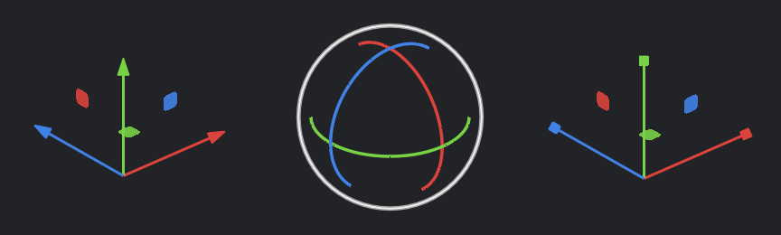
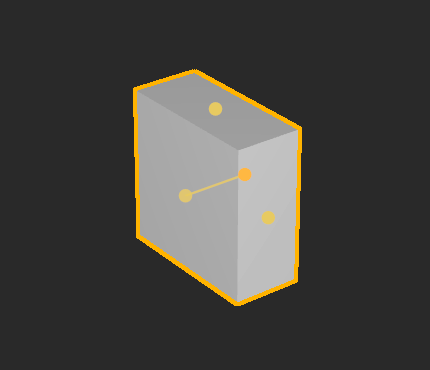

# Auik Guizmo Extension

An extension that provides interactive editing widgets for the [Auik](https://repos.wusikijeronii.me/app3d/auik) UI library.

## Widgets

### Curve Editor

Edit Bézier curves by selecting and moving control points and their tangent handles on a customizable grid.

### Axis Manipulator

Move, rotate, and scale objects in a 3D viewport. Move and scale support axis and plane handles, and rotation can follow an axis or the view direction.

### Control Manipulator

Drag a point along a chosen axis to edit a value. An optional line connects the control to a second point. The line can stay visible or appear during the drag.

## Building
Auik is distributed as a CMake project and is intended to be integrated as a submodule.

### Supported compilers:
- GNU GCC
- Clang

### Supported OS:
- Linux
- Microsoft Windows

### Bundled submodules
The following dependencies are included as git submodules and must be checked out when cloning:
- [acbt](https://repos.wusikijeronii.me/app3d/acbt)
- [auik](https://repos.wusikijeronii.me/app3d/auik)

## License
This project is licensed under the  [MIT License](LICENSE).

## Contacts
For any questions or feedback, you can reach out via [email](mailto:wusikijeronii@gmail.com) or open a new issue.